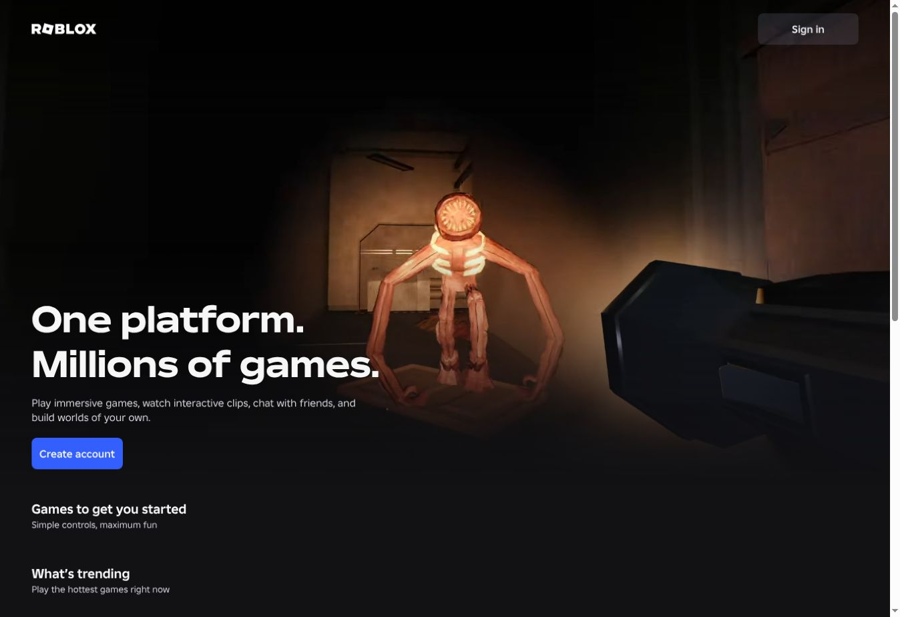
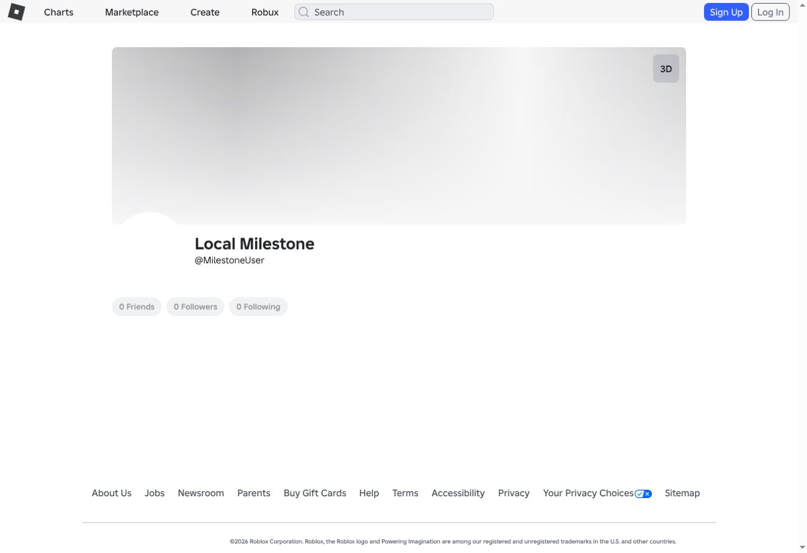

> **Incomplete upload:** 53 captured objects could not be published. This checkout is not the complete runnable milestone. See [UPLOAD_STATUS.md](UPLOAD_STATUS.md) for the exact omissions and reasons.

# Self-hosted 2026 Roblox — original-client preservation

This is an initial preservation milestone using captured browser-delivered Roblox documents, JavaScript, CSS, fonts, images, and the original landing video. There are **zero custom HTML pages, UI replacements, or generated visual assets**. Python supplies an offline resource gateway and independent SQLite services.

## Run locally

Requires Python 3.11+ with OpenSSL/scrypt support. There are no Python or npm runtime dependencies.

```sh
python3 server.py --port 3000
```

Open `http://localhost:3000/`. Original captured routes include `/login`, `/CreateAccount`, `/catalog`, `/charts`, and `/login/forgot-password-or-username`. A captured route is not a claim that its backing service is implemented.

For another machine, use `--host 0.0.0.0`. When serving behind a reverse proxy, set `PUBLIC_ORIGIN` to the exact deployment origin and forward the original Host and scheme. Use HTTPS outside local development. SQLite state lives in `data/platform.sqlite3` and must be backed up separately.

Docker is optional:

```sh
docker build -t roblox-preserved .
docker run --rm -p 3000:3000 -v roblox-data:/app/data roblox-preserved
```

## Current scope

Browser QA verified the actual signed-out landing, login, signup, Marketplace, Charts, and public-profile components. The landing hero images and the original HLS video play from captured local files; the browser verified 1920×1080 playback. Fonts, icons, and styles are captured resources.

The account owner's two authenticated captures supplied six original documents: Home, account settings, avatar, friends, profile, and inventory. The captures contain identical public static resources. All 101 reported image-CDN capture failures have been recovered through anonymous public requests. The active store contains 768 captured resources, including all 116 bundle references embedded in the original lazy-loading declarations and two public asset/category mapping responses used by Inventory.

**Production game data is not used as independent platform data.** The raw landing capture contains historical server-embedded recommendations and hydration records. The serving adapter clears all production game items and hydration maps while preserving the original SDUI component structure, templates, localization, and static artwork. The current landing renders empty original game sections. No production game recommendations, ratings, player counts, or links are replayed to fill the empty platform.

The gateway performs no outbound HTTP requests. The browser transport adapter routes platform requests to local services and a Content Security Policy confines resource and data requests to the local origin. Unknown services respond with explicit errors; the original client chooses its own error/loading/fallback behavior. There is no live Roblox reverse proxy and no real-account or payment integration.

Implemented backend pieces include SQLite local identities, salted scrypt passwords, hashed expiring sessions, CSRF checks, local login/logout, user lookup, a minimal local profile response, SQLite catalog search/details, and account-settings, fictional-balance, and friends-list read projections. Display names, original account-theme values, and inventory visibility can now be changed through the client's actual API contracts and persist independently. Inventory reads filter by asset type and paginate only locally owned catalog records. Local catalog and inventory results are empty until local records exist.

Most services—including signup completion, recovery delivery, recommendations, games, avatar rendering, friendship mutations, presence, purchases, other settings, asset-content upload/delivery, and game sessions—remain incomplete. Persistent tables and captured pages alone do not make those features complete. A catalog record does not imply that its asset bytes or thumbnail are available.

The separate public `/home` capture remains the original upstream redirect to login. A valid independent session selects the captured authenticated Home document instead. Settings, avatar, friends, and inventory documents require a valid local session. Profile documents bind the target local user's ID separately from the viewing user's metadata. Guest-only landing/login/signup/recovery documents redirect signed-in users to Home. No real Roblox session is used or accepted as a local session.

HTTP integration checks verify all six documents, their original component mounts, local identity and CSRF binding, guest access controls, and logout revocation. Authenticated interactive browser rendering has not yet been verified; these checks do not establish that every original page completes its missing API calls.

## Settings and inventory services

The implemented settings endpoints are on the original `apis.roblox.com/user-settings-api` service prefix. They support `accountTheme` and `whoCanSeeMyInventory`; unsupported settings return explicit errors. Updates validate every submitted field before persisting any change. Mutations require the owning independent session and its CSRF token. Display-name validation uses the original client's numeric error-code contract with independent local validation rules, and updates cannot edit another user.

Inventory visibility supports Everyone, Friends, and No One, with the owner always able to read their inventory. The API checks the policy on every request; it also binds the original captured `can-view-inventory` attribute for the client’s own private-inventory state. Asset-type filters, sorting, cursor scope, and pagination run against SQLite. The category hierarchy is read directly from the original Inventory bundle's fallback constants without executing JavaScript or rebuilding the interface. The catalog-details endpoint supplies only matching local records, with no fabricated image URLs.

`evidence/backend-service-contracts.json` records the captured bundle URLs, hashes, offsets, and excerpts used for these implementations. An integration test executes the original settings option-filter function against actual local HTTP responses. Backend compatibility checks do not substitute for signed-in interactive browser QA.

Operators can create their own catalog records and grant them without adding an administration page:

```sh
python3 manage.py create-asset --owner 1 --type 18 --name "My local face"
python3 manage.py grant-asset --user 1 --asset 1
```

Use the actual local user and asset IDs printed by the commands. These are database records only; asset bytes, avatar rendering, and thumbnail generation remain separate unfinished services. The distributed project contains no sample accounts, assets, inventory, or balances. The development preview has one independent `MilestoneUser` QA account; the original public-profile component was browser-verified rendering its locally stored display name, `Local Milestone`.

## Original authentication code

`evidence/original-auth-check.js` contains an exact excerpt of the captured CoreUtilities bundle. It reads `meta[name="user-data"]` and derives authentication from its presence. `evidence/original-auth-check.json` identifies its original URL, SHA-256, and offsets. These functions are not replaced or rewritten. A valid independent session supplies the metadata consumed by the original code on shared pages. Guest responses have no such metadata. The tests execute the recovered code with metadata obtained from actual local HTTP responses.

This describes the browser-side mechanism only. Roblox's original server-side source and authorization middleware are not part of the public web capture; this project implements its own server-side session validation.

## Signed-out Play is a distinct original flow

The captured `GameLaunch` bundle contains the original `restrictGuests` check. A signed-out user gets the original sign-up/login dialog while the deferred launch remains unresolved. An authenticated user takes a separate branch. The bundle also contains the modern missing-user redirect guard and the `GuestProhibited` Play-button branch; these are preserved without a custom Play handler.

On 2026-10-26, a signed-out browser click on the official game's `data-testid="play-button"` control displayed the original **Sign in or create a free account** dialog. The script URL in that page matched the captured GameLaunch bundle exactly. This was a read-only inspection of public frontend behavior; the production game record was not imported into the local games database.

`evidence/original-play-branches.json` identifies source hashes and exact excerpts. Tests execute those recovered branches, verify that a guest never reaches the join callback, verify the authenticated branch stays separate, and verify login/signup preserve the local return-to-game URL. Another HTTP test verifies that the served bundle still contains the exact recovered functions. These tests validate preserved code; a local game detail page and local game-session infrastructure are still required before claiming end-to-end local Play functionality.

## Capture authenticated documents in your own browser

`tools/auth_capture/capture-authenticated.js` is a DevTools Console/Snippets script for a browser that is already signed in to Roblox. It fetches original document responses and public static bundles without reading cookies or browser storage, recording account API response bodies, or uploading anything. It scrubs recognized bootstrap values and downloads a review-required JSON capture. Cross-origin resources that CORS blocks are listed as missing, not claimed as recovered. Review the exported HTML for remaining personal details before sharing it.

The companion importer validates hashes and quarantines documents without altering the active guest capture or importing real account values into SQLite. The supplied captures have been reviewed and separately normalized into the six active templates in `capture/authenticated/manifest.json`. `auth_documents.py` binds only independent identity, target-page identity, and session security data; it constructs no interface components. Source response hashes are reported by the owner's capture script; normalized template hashes are independently checked during serving and audit. Raw quarantined documents and runtime account databases are excluded from the distributed project. See `tools/auth_capture/README.md` for the capture/import workflow and limitations.

## Capture provenance and transformations

`capture/manifest.json` records exact source URLs, redirects, content types, byte counts, timestamps, and SHA-256 hashes. `capture/objects/<sha256>` contains the original downloaded representation. Original files remain unchanged. Static CDN/asset-delivery media is replayed from this store; no substitute thumbnail is fabricated.

The serving layer performs only deployment/data adaptation: resource URL rebasing; transport decoding; Content Security Policy; the local transport script; removing stale integrity values for changed representations; preserving local preview ports; independent bootstrap metadata; clearing production data; and binding the original documents' identity fields to local users. The original video SDK's non-production environment selection is routed to the local captured-media service. It never connects to a Roblox test server.

Some referenced source-map URLs returned empty bodies, and the catalog search-options endpoint returned 404. These are recorded, not claimed to be recovered. Superseded HLS query-template errors are retained separately from current failures.

Use `python3 audit.py` to verify capture hashes and regenerate the evidence report. `data/unimplemented.jsonl` records missing method/host/path combinations without request bodies, credentials, cookies, or query values. Public thumbnail identifier diagnostics can appear in `data/thumbnail-requests.jsonl`; these requests remain unimplemented until the platform's own thumbnail service exists.

## Verify

The test suite requires Node.js in addition to Python because it executes the exact recovered authentication functions:

```sh
python3 -m unittest discover -s tests -v
python3 audit.py
```

Use `python3 manage.py create-user LocalName` to create an independent account with a securely prompted password, then sign in through the original captured login page. Do not use a real Roblox password. This command does not claim that signup or all authenticated page services are complete.

`capture.py` is an explicit capture-time tool; it is never invoked by the serving process. It uses no Roblox login cookies and follows only allowed public Roblox/CDN references. No task here obtains private Roblox source code, production backend access, or game-server infrastructure. Capturing material does not grant permission to modify or redistribute it; no such rights are asserted by this project.

## Milestone screenshots




